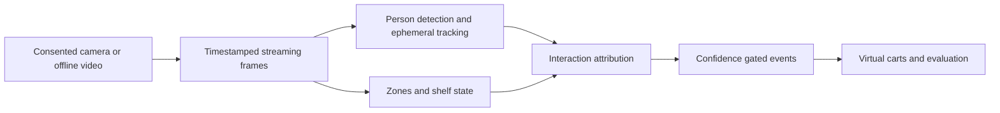

# Cashierless Retail Tracker

A privacy-first **single-camera research prototype** for detecting mock-shelf interactions and maintaining ephemeral virtual carts. This is not a real checkout system.

[](https://github.com/DanyVX/cashierless-retail-tracker/actions/workflows/ci.yml)

## Demo
TBD: no consented, redacted demo has been approved for publication.

## Key results
| Metric | Measured value |
| --- | --- |
| Tracking HOTA / MOTA / IDF1 | TBD (not yet measured) |
| PICK / RETURN event F1 | TBD (not yet measured) |
| Exact-cart match | TBD (not yet measured) |
| CPU throughput (FPS) | TBD (not yet measured) |

This table is intentionally not an accuracy claim. All future figures must be generated from checked, script-produced `results/*.json`, with environment and Git commit metadata.

## Why this exists
Demonstrate a small, auditable perception pipeline for a mock shelf with 5–10 known SKUs. Controlled, consenting participants only. No face recognition, persistent identity, payments, public-space filming, or real-store claims. Ambiguity must be surfaced, never quietly billed.

## Architecture

M0 implements configuration, privacy gates and environment diagnostics. M1 implements streaming video I/O with explicit discontinuities. Detection, interaction inference and carts remain **planned**, not functional.

## Quickstart
Python 3.11+; with `uv`:
```bash
uv sync --extra dev
uv run crt-env
uv run pytest
```
With pip: `python -m pip install -e '.[dev]'`, then `crt-env` and `pytest`. Note: clean-machine installation is **not yet verified** and a `uv.lock` cannot be produced in the offline build sandbox (see [environment](docs/ENVIRONMENT.md)).

## Usage examples
`python tools/probe_video.py private_clip.mp4 --consent-confirmed --max-frames 100` reads a consented private mock-shelf clip without saving frames; use `--synthetic` for generated clips. See [video I/O](docs/VIDEO.md).
`crt-env --output environment.json` produces a non-identifying hardware/toolchain snapshot. Add `--check-network` to opt into a reachability probe. No video is read in M0.

## Configuration
See [`.env.example`](.env.example). `CRT_BLUR_FACES=true`, `CRT_REQUIRE_CONSENT=true`, `CRT_STORE_RAW_FRAMES=false` and zero retention are defaults, validated through `pydantic-settings`. Capturing participants requires external verified consent. **All media publication is denied** until face-blurring is implemented, measured, and reviewed.

## How to reproduce benchmarks
M1 contains a synthetic-only CPU video decode smoke benchmark: `python bench/bench_video.py --frames 30`. No detection/tracking/cart metrics have been measured. Future `bench/` and `eval/` scripts must save a Git SHA, hardware and dependency versions with every actual measurement. Metrics must be rendered, not typed into this README. See [results plan](docs/RESULTS.md).

## Design decisions
See [DESIGN.md](docs/DESIGN.md) and the [recording protocol](docs/RECORDING.md).

## Limitations
M0 has no detector, tracker, video I/O, pose, shelf reasoning, carts, or validated face blur. See [LIMITATIONS.md](docs/LIMITATIONS.md).

## Roadmap
M0 setup and consent → M1 video I/O → M2 tracking → M3 zones/hands → M4 shelf change → M5 events/carts → M6 evaluation → M7 privacy safeguards → M8 visualization/release.

## License
MIT for original code only. Every third-party package, dataset and pretrained model has separate terms; see [DATA.md](DATA.md) and [MODEL_CARD.md](MODEL_CARD.md).

## Acknowledgements / citations
Methods and specific pretrained models will be cited when implemented. OpenCV wheel redistribution also requires reading FFmpeg/third-party notices in its [PyPI license information](https://pypi.org/project/opencv-python/).
