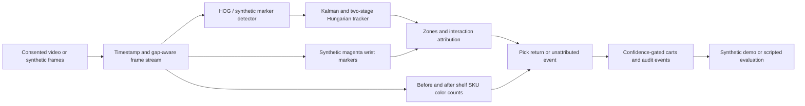

# Cashierless Retail Tracker

**A privacy-first, single-camera cashierless *mock-shelf research prototype***. Tracks temporary sessions, infers shelf picks/returns conservatively, and maintains nonnegative virtual carts. No person identification, payments, theft monitoring or claims of production accuracy.

[](https://github.com/DanyVX/cashierless-retail-tracker/actions/workflows/ci.yml)

## Demo

Generate an entirely synthetic annotated example locally:

```bash
python tools/run_demo.py --out results/demo
```

The command writes `synthetic.gif` (requires ffmpeg) and `events.json`. This is a controlled colored-marker simulation, **not actual retail footage or validated shopper recognition**. No participant images are published.

## Key results

| Criterion | Status |
| --- | --- |
| MOT17/MOT20 HOTA, MOTA and IDF1 | **TBD (not yet measured)** |
| Tracking on >=3 consented real mock-shelf clips | **TBD (not yet recorded)** |
| Real PICK/RETURN precision/recall/F1 | **TBD (not yet measured)** |
| Real final-cart exact-match | **TBD (not yet measured)** |
| Face redaction miss-rate on real labeled faces | **TBD (not yet measured)** |
| CPU decode/marker demonstration | Reproducible scripts; no copied or fabricated numbers |

Synthetic scenario calculations are written only by `eval/run_synthetic.py` to a local JSON file with Git commit and machine configuration. They are toy self-tests, not a substitute for the real-world results above.

## Why this exists

To build a small, explainable system with privacy and failure detection at its core. It uses explicit **unattributed/review** states when shopper ownership or SKU certainty is insufficient.

## Architecture



Tracking uses ephemeral IDs; cross-session person re-identification and face recognition are intentionally absent. Real wrist and product detection are **not implemented**, so the synthetic end-to-end demo does *not* prove a cashierless store works.

## Quickstart

Python 3.11/3.12 and ffmpeg for GIFs. `uv` preferred:

```bash
git clone https://github.com/DanyVX/cashierless-retail-tracker.git
cd cashierless-retail-tracker
uv sync --extra dev
uv run pytest
uv run python eval/run_synthetic.py
uv run python tools/run_demo.py
```

Pip fallback: `python -m pip install -e '.[dev]'`, then use plain `python`. This environment did not generate a lockfile because direct registry access was blocked in the original sandbox. GitHub CI performs separate fresh-install checks. See `docs/ENVIRONMENT.md`.

## Usage examples

`crt-env --output environment.json` prints a privacy-minimized environment snapshot. `python bench/bench_video.py --frames 30` measures synthetic MJPG decoder performance. `python tools/probe_video.py private.mp4 --consent-confirmed` requires privately verified consent and does not export frames. `python tools/calibrate_zones.py --width 200 --height 120 --points 90,10 185,10 185,100 90,100 --zone A --sku chips` saves normalized calibration geometry.

Generated evaluator: `python eval/run_synthetic.py --out results/synthetic_eval.json`.

## Configuration

All privacy settings via `pydantic-settings` from `.env.example`. Default: blur enabled, consent required, raw frame storage disabled, retention zero. Do not add real camera credentials to Git. Publication of real participant media is blocked because the face-blur miss rate is unmeasured.

## Benchmark reproduction

`python eval/run_synthetic.py` records actual generated scenario outcomes to a JSON file, with environment/Git metadata. `python bench/bench_video.py` measures decoder throughput. No real MOT/TrackEval results have been produced. See [evaluation](docs/EVALUATION.md) and [results](docs/RESULTS.md).

## Design decisions

See [design log](docs/DESIGN.md), [video I/O](docs/VIDEO.md), [shelf](docs/SHELF.md), [cart](docs/CART.md), [privacy](docs/PRIVACY.md), [demo](docs/DEMO.md), [annotation guide](docs/ANNOTATION.md).

## Limitations

The model backends have not been benchmarked on real shelf video. The colored-marker person/wrist/SKU semantics exist only in generated demo scenes; OpenCV HOG is a weak pedestrian baseline. No full ByteTrack, official TrackEval HOTA/IDF1, data-informed calibration, multi-camera view, exit-line cart session closure, or real payment. Read [limitations](docs/LIMITATIONS.md) and [failure cases](docs/FAILURES.md).

## Roadmap

M0 repo/privacy foundation; M1 video/timing; M2 track baseline; M3 zones/interactions; M4 color SKU state; M5 cart; M6 synthetic evaluation; M7 redaction and restricted publication; M8 synthetic demo/event buffer. **Future validation**: consented mock recordings, measured face-blur recall, real pose/SKU model with checked licenses, TrackEval and oracle ablations, proper robustness/fairness analyses.

## License

MIT for original repository code. See [DATA.md](DATA.md) and [MODEL_CARD.md](MODEL_CARD.md) for wheel, model and dataset-specific licensing caveats.

## Acknowledgements / citations

OpenCV pedestrian HOG and Haar classifiers are from OpenCV's built-in distribution; SciPy supplies Hungarian matching. Formal methods references and official MOT benchmark sources are documented as future validation requirements, not claimed replicated paper results.
